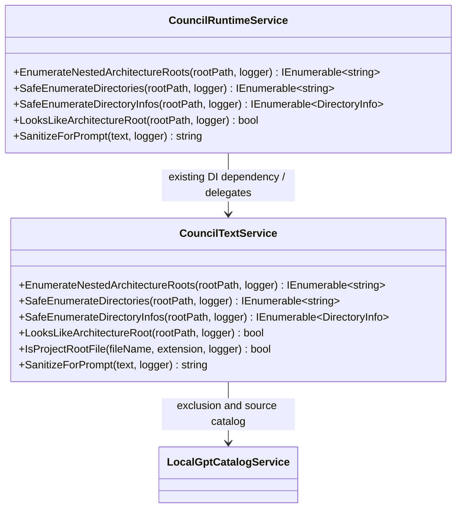
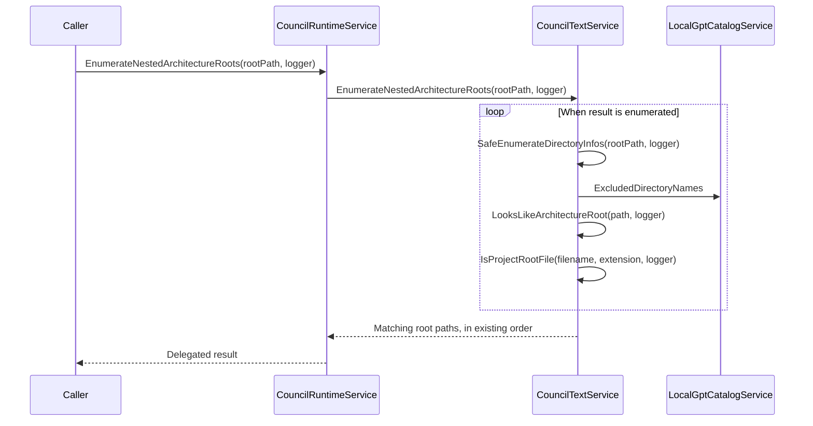

# LocalGPT 5.8.9 — UML-guided service contract equivalence

## Scope and result

A source-level review of the LocalGPT 5.8.8 service implementations and interfaces looked for matching method inputs/outputs **and** equivalent responsibility, observable behavior, downstream calls, failure behavior, and service lifecycle. It did not treat a matching C# method signature alone as proof of equivalence.

The initial automated candidate search examined 374 C# service implementation files and extracted approximately 3,126 plausible method bodies. This was a heuristic candidate inventory, not a C# compiler or a complete semantic proof. Cross-file matches were manually compared before the refactor.

## Consolidated responsibility: Council architecture-source classification

`CouncilRuntimeService` and `CouncilTextService` contained five equivalent operations:

| Existing public method | Signature/result | Equivalent behavior |
|---|---|---|
| `EnumerateNestedArchitectureRoots` | `(string rootPath, ILogger logger)` → `IEnumerable<string>` | Traverses descendants using the same sorted directory enumeration, exclusions, and root classifier; same iterator completion log |
| `SafeEnumerateDirectories` | `(string rootPath, ILogger logger)` → `IEnumerable<string>` | Same case-insensitive ordering and caught-error empty return |
| `SafeEnumerateDirectoryInfos` | `(string rootPath, ILogger logger)` → `IEnumerable<DirectoryInfo>` | Same excluded-directory filter, path ordering and caught-error empty return |
| `LooksLikeArchitectureRoot` | `(string rootPath, ILogger logger)` → `bool` | Same marker-file and distinctive child-directory tests; runtime version already called `CouncilTextService.IsProjectRootFile` |
| `SanitizeForPrompt` | `(string text, ILogger logger)` → `string` | Identical user-name redaction, NUL removal and caught-error empty-string behavior |

**Decision:** Keep the authoritative implementations in the existing `CouncilTextService`, which already owns the marker-file classification. Retain the five `CouncilRuntimeService` public signatures as transparent delegations to its **existing injected `CouncilTextService` dependency**. This removes duplicate rule definitions while preserving all callers and leaving registration lifetimes unchanged. No new service, base class, static helper, generic repository, API, or business policy was introduced.

### UML class relationships after refactor

### UML sequence (read-only architecture classification)

Because the original return is a lazy iterator, `CouncilTextService` still executes and logs iterator completion **at enumeration time**, rather than eagerly during delegation. Public method names, parameters, result types, caller-facing error fallback values, and the shared catalog instance are preserved.

## Related candidates deliberately NOT merged

| Candidate pair/group | Similarity | UML and behavioral decision |
|---|---|---|
| `ProjectMaintenanceService.HashFileAsync`, `ProjectIngestionService.HashFileAsync`, `CodeGenerationWorkflowService.ComputeFileHashAsync`, `LearningProjectWorkspaceSyncService.ComputeFileHashAsync` | File path + cancellation → SHA-256 string | **Not equivalent as currently specified.** Learning sync returns lowercase hex; other paths return uppercase. Stream sharing/buffering and diagnostic contracts also differ. Normalize the hash identity contract first, then consider a shared, cancellation-aware file-integrity service only if worthwhile. |
| `RemoteControlConnectorService` and `RemoteControlPipelineService` | `GetAsync/DeleteAsync`, key normalization, bounded text | **Keep separate aggregates.** Connector settings and pipeline definitions have different referential and execution obligations. Shared key grammar might deserve a small service if business policy starts diverging, but genericizing both repositories would erase domain ownership. |
| `CouncilLiveSessionService.Get/Complete` and `CouncilRunConfigurationService.Get/Complete` | Same method names and `Guid` inputs | **Not equivalent.** Live participant state and run-configuration state have different lifecycles and postconditions. Do not fuse their state holders. |
| `UserDxAiFunctionService` and `RuntimePluginService` | Descriptor, invocation, refresh operations | **Keep distinct trust/authorization boundaries.** User-owned functions and runtime plugins must retain separate governance despite identical function interface shapes. |
| `HardwareInventoryService.InferVendor` and platform probe `InferVendor` methods | `string` → `string` | **Not equivalent.** Platform probes recognize vendors not recognized by generic inventory (including Apple); output can differ for the same input. |
| `RegexCompilationService.ParseOptions` and `RegexEngineService.ParseOptions` | Same flag input → `RegexOptions` | **Already correctly unified.** The compilation service delegates to the regex engine, while retaining its independent policy ownership. This is a good existing UML pattern. |
| `DxAiFunction` adapters `InvokeAsync` | Repeated request/cancellation → response shape | **Intentional polymorphism.** Different function adapters share a framework interface, not a business reaction. Their methods should not be merged because their signatures match. |

## Constraints and runtime verification

- All original repository files are retained. Only the two Council runtime partials and the LocalGPT project version have behavioral/source edits.
- Original `CouncilRuntimeService` public entry points and XML comments stay in place; consumers do not need changes.
- `CouncilTextService` already supplied the classifier and was already injected into `CouncilRuntimeService`; no DI registration or lifetime changes.
- No change to source-safety policy, database schema, UI, PDF output, function approvals, or Council workflow.
- Manual static analysis is not a Windows build. Exercise nested-root discovery, missing/inaccessible folders, prompt redaction, iterator disposal, and a normal Council learning run after compilation.
