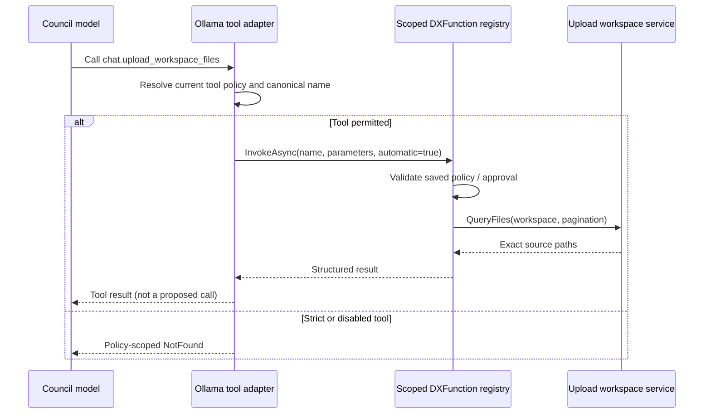
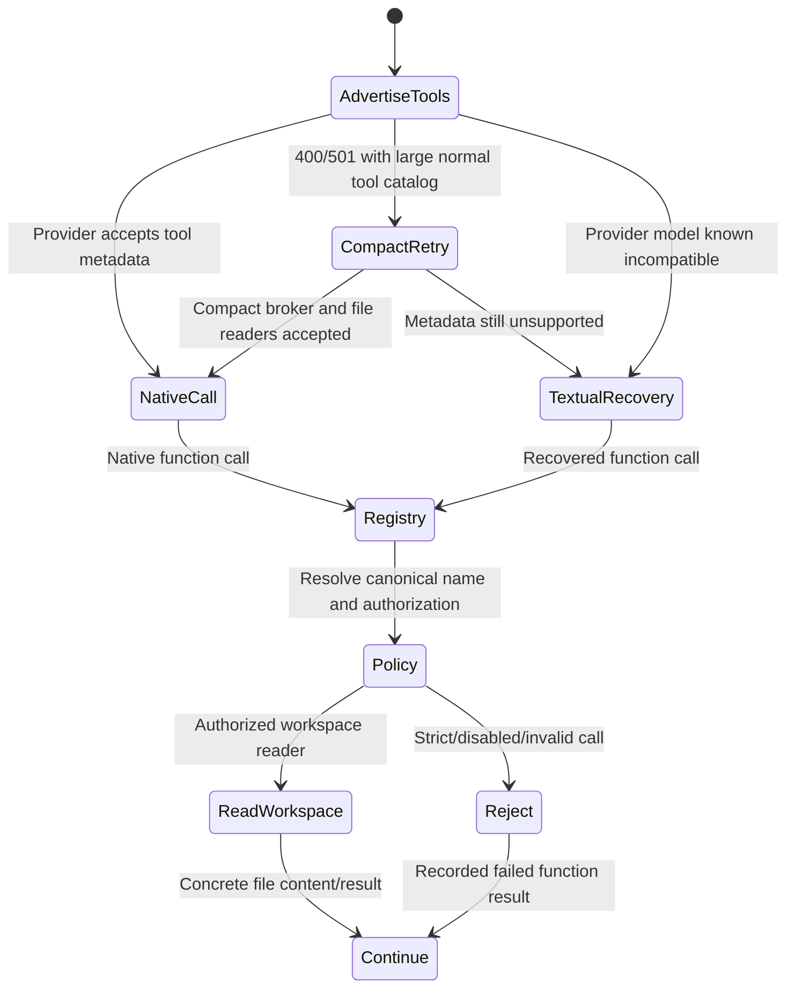
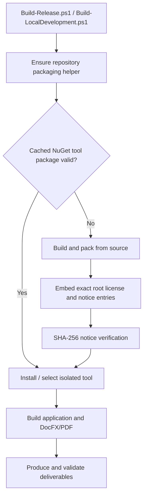

# Chat and Council runtime

## Session boundary

A chat session combines a selected provider route, protocol profile, formatter, prompt configuration, function catalog, and bounded context. These dependencies are resolved through services and remain stable for the response stream.

Protocol profiles are stateless. They detect provider/model families and normalize only their own control markers. The response formatter owns presentation of thinking, final content, tools, code, and structured sections.

A Blazor circuit is a presentation adapter, not the lifetime of a Council run. [Reactive lifecycle and process equivalence](reactive-lifecycle-and-process-equivalence.md) records the UI attachment/unsubscription sequence and the boundary with server-owned Council work.

## Council orchestration

A Council request is decomposed into explicit workflow steps. The runtime owns:

- team and member configuration;
- provider-qualified route resolution;
- preflight and readiness checks;
- role/task prompts;
- step ordering and cancellation;
- human questions and decisions;
- final-result composition;
- durable summaries and artifacts where appropriate.

The spooler represents queued/running work. Runtime classes describe reusable behavior or game actors, but they do not bypass the workflow service.

### Workflow execution modes

Council workflow steps can choose how role members consume the available AI hardware:

- `AllMembersParallel` allows up to the configured model-lane limit on each participating AI host. Separate hosts remain independent compute boundaries.
- `AllMembersSequentialOnEachAIHostParallel` is the default for newly created workflow steps. It creates one deterministic queue per AI host, runs exactly one member at a time inside each queue, and lets the host queues advance concurrently. The phase barrier still waits for every assigned member before the next workflow step starts.
- `AllMembersSequential` is the strict global chain. Only one member runs at a time across every host and later members may observe the earlier completed step output.
- single-member modes (`LeaderSingle`, `RoundRobinSingle`, `AssignedModelSingle`) select one exact participant according to the saved workflow contract.

The per-host sequential mode intentionally gives every member the transcript that existed when the phase began. It does not merge race-dependent output from another host into an in-flight peer prompt. Use strict global sequential execution when each member must review the immediately preceding member.

`AllowParallelHardwareRoads` controls additional CPU/GPU-road concurrency inside an AI host; it no longer collapses different physical/provider hosts into one global runtime lane.

## Deterministic completion

Models are probabilistic; step completion is not. The application evaluates whether a response contains substantive final content, whether required outputs exist, and whether a bounded recovery is allowed.

A verifier can add confidence or a warning. It cannot retroactively make an invalid primary result valid. Conversely, a failed verifier should not erase a valid result when the workflow contract treats verification as advisory.

## Human collaboration

Human participation is modeled as a request and decision flow with an exact question, boundary, status, and optional reuse scope. It supports:

- answering a Council question;
- choosing among alternatives;
- reviewing a proposed change;
- approving a bounded operation;
- contributing domain knowledge.

A human decision is bound to its context. It is not a global bypass token.

## DX functions

DX functions expose typed application operations to chat and Council workflows. The catalog describes parameters and capabilities. The handler/service still owns validation, policy, and execution.

Functions should return structured outcomes that distinguish:

- success;
- user decision required;
- capability missing;
- validation failure;
- execution failure;
- partial/reviewable output.

## Change reviews

Generated changes are stored as reviewable records rather than immediately applied. A review can include proposed files, diffs or replacement content, architecture findings, build instructions, execution evidence, and user decisions.

The workflow can approve a revision for testing without marking it released or deployed.

## Knowledge

Council knowledge is persistent but curated. Automatic context uses reviewed, active, non-expired entries whose provenance is acceptable. Source-backed knowledge is refreshed when its source hash changes. Raw uploads and model answers do not become trusted knowledge automatically.

## GameDirector reuse

GameDirector uses the same Council machinery for role-assigned world actors while retaining a deterministic authoritative resolver. This is an example of the intended architecture: generative proposals inside a strict application-owned state machine.

## Native automatic functions and the Council tool contract

The DXFunction handler registry and the per-provider *advertised function list* are different runtime contracts. Handler registration means a function exists, not that an Ollama participant can call it in its current workflow step. When diagnosing `The requested automatic function is not registered`, inspect `OllamaThinkingChatClient.ResolveRegistryFunctionName` **before** assuming that the upload workspace or DI service disappeared.

- **Unrestricted** (`automaticFunctionAllowList == null`): as in LocalGPT 5.5.0, all registered functions marked `AvailableToAi`, `SupportsDirectInvocation`, and `SupportsAutomaticInvocation` are offered as native functions. The central registry still enforces function policy and approvals.
- **Preferred tools** (normal team, nonempty list plus `dxai.tools.invoke`): named functions are offered directly; discovery/preview/invoke exposes the broader policy-approved catalog without advertising all schemas. The resolver also accepts an eligible known function name even if it wasn't preferred, as a direct-call compatibility path; registry validation is unchanged.
- **Strict tool allowlist** (explicit strict team/step or live game runtime): only the saved names can be called. The unrestricted broker is excluded from strict lists and the resolver cannot fall back to other names.
- **Disabled**: no native automatic functions are attached and no automatic function result should be dispatched. Neither an upload manifest nor a curator receipt constitutes a model-performed source-file read.

**Migration note:** Between the provided 5.6.1 and 5.7.1 source versions, a `null` tool list was reinterpreted as *broker-only*. LocalGPT 5.9.1 restores the unrestricted 5.5.0 behavior. Existing persisted Council team/step choices remain authoritative; no saved preferences or strict settings are rewritten during migration.

## Provider-native tool compatibility and workspace access

LocalGPT's uploaded-file reader is an **application capability**, not a Game Project
Development Team-specific feature. Direct chat and Council both use the same
scoped DXFunction registry and the same Ollama tool adapter. The runtime process
must not infer absence of uploaded files from a tool-name resolution failure.

In unrestricted direct chat, the normal first attempt still advertises the eligible
function catalog. If a provider rejects a **large** native schema request, retry a
compact **shared** directory of DXFunction discovery/preview/invoke and the
`chat.upload_workspace_*` readers, rather than immediately disabling all native
tools. In text-only recovery, the compact directory avoids overwhelming a small
model's context; additional capabilities remain discoverable through the policy-
checked broker. An explicit strict workflow policy is **not** broadened.

The broker's invoke operation requires a preceding preview fingerprint; discovery
alone is not approval or proof of a file read. Each tool result must be returned to
the model, and the Council's separate source-evidence gate must observe a *successful
read* before accepting source-dependent conclusions. Resolution failures now log
a bounded tool name, provider model, and policy dimensions without exposing files.

The same runtime source files contain the direct-chat path. A successful static
inspection alone does **not** establish that a real Ollama/LM Studio model can
complete a chat or read a file: both need end-to-end provider replays.

## One-command release and development packaging

No user-run package publication command is a precondition. A missing or corrupted
local NuGet helper package is rebuilt automatically; a rebuilt package must pass
its original SHA-256 license-content guard or the single build command fails.
The helper still owns its own version and its package version only changes when
that helper's distributed contents change.
