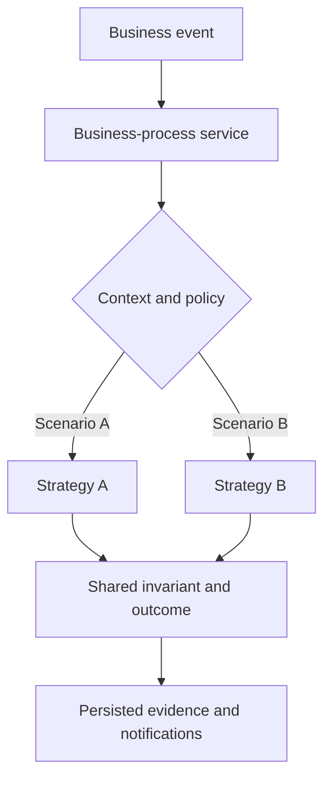
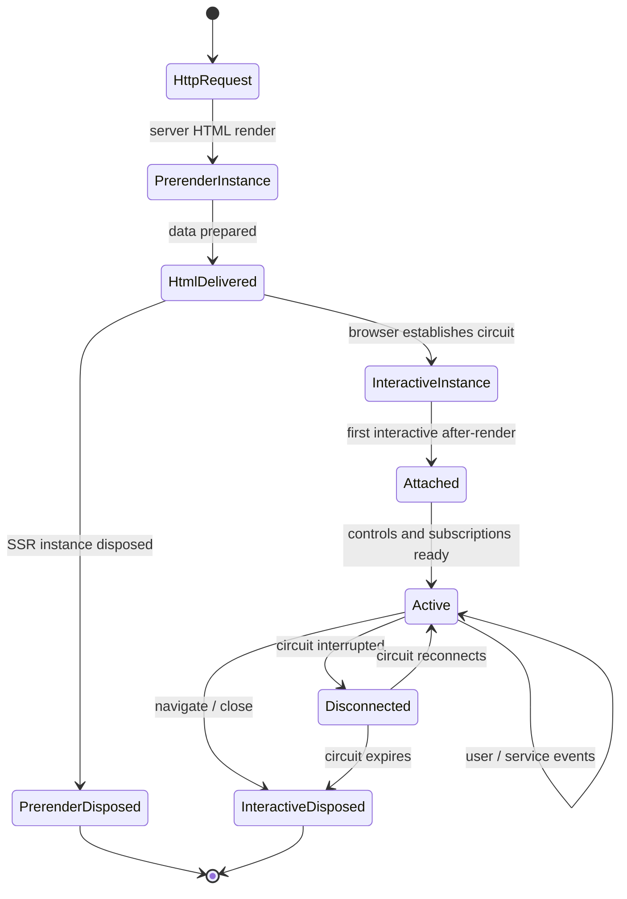
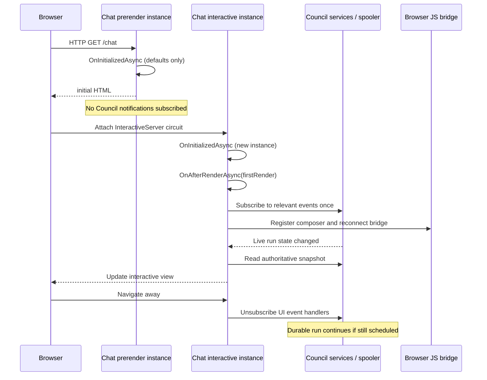
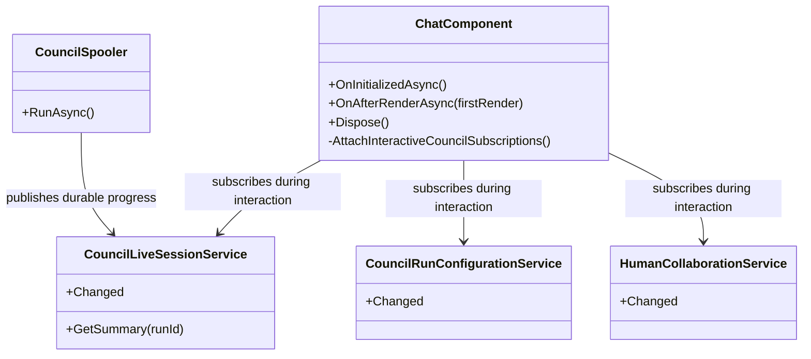

# Reactive lifecycle and business-process equivalence

LocalGPT treats time, requests, user input, model output, hardware signals, and database changes as **events** to which services react. A sequential step is an ordered reaction, not an alternative to reactive architecture. Application services own decisions, process state and side effects; Blazor components adapt renderer events to those services.

This document is a UML-oriented method for finding accidental duplicate business processes **without** merging different runtime contracts just because C# signatures match. Use it alongside [Frontend and themes](frontend-and-themes.md), [Council runtime](council-runtime.md), and [Projects and persistence](project-data.md).

## Equivalence is contextual

Two methods with identical input and output types need not implement the same process. Conversely, two different services may implement one business process through different mechanisms. Evaluate a candidate across **all** of these axes:

| UML view | Equivalence question | Evidence to collect |
| --- | --- | --- |
| Use case / activity | Is the actor requesting the *same outcome*? | Initiating event, acceptance criteria, alternative flows |
| State machine | Which states enable the reaction, and what changes afterward? | Precondition, transition, retry/idempotency, cancellation |
| Sequence | Who owns the conversation and side effects? | Service dependencies, call order, persisted writes, emitted events |
| Class / responsibility | Is this one reason to change or two independent policies? | Interfaces, invariants, lifetime, aggregate ownership |
| Execution context | Can both reactions run in the same environment? | Prerender/interactive, HTTP/circuit/worker, authorization context |
| Observable contract | Does one implementation preserve every promised behavior? | Return values, errors, diagnostics, timing, permissions |

First compare the **business process**; only then choose shared services, strategy variants, or deliberately distinct flows. Never replace an authorization, durability, or lifecycle boundary with a generic helper merely to reduce method count.

## One process with distinct strategies

The diagram below describes a *candidate* consolidation, not a claim that every similarly named LocalGPT service is presently equivalent.

The owner must be a real scoped/transient/hosted service with a justified lifetime, not a new static utility or global singleton. A shared strategy abstraction is justified only when it reduces duplicate business rules without concealing differences.

## Blazor: same method, different runtime process

`@rendermode InteractiveServer` normally prerenders the first HTML and later creates an **independent interactive component instance**. `OnInitializedAsync` can run for *both* instances. They have the same method signature but different capabilities and service scopes. It is incorrect to model them as a single component instance transitioning in place.

- **Prerender:** Prepare an HTML view from safe/read-only application state. Browser JS interop and `OnAfterRenderAsync` are not available. Avoid starting a Council run, establishing circuit-bound subscriptions, or overwriting user settings with temporary defaults.
- **Interactive attach:** The interactive instance initializes; its first `OnAfterRenderAsync` confirms an attached renderer. UI-specific subscriptions, JavaScript bridge setup, and activation may begin when their dependencies are ready.
- **Live interaction:** Service changes and user commands drive reactions. A supervised application service or spooler, not the UI component, owns durable Council work.
- **Disconnect/disposal:** A circuit can temporarily disconnect; a disposed component unsubscribes and cancels its own UI tasks. A running Council job is not implicitly cancelled because a page stops rendering.

Some reviewed islands deliberately use `InteractiveServerRenderMode(prerender: false)` because their first meaningful operation requires the circuit. Other routes retain prerendered HTML. This difference is part of the runtime contract rather than an implementation inconsistency.

### UML state view — separate component lifetimes

`PrerenderDisposed` and `InteractiveDisposed` refer to **different instances**. A permanent failure to attach must be reported, not interpreted as successful domain-work completion.

### UML sequence view — Chat and Council

### UML responsibility view — domain lifetime is not a renderer lifetime

The class diagram names conceptual responsibilities (not a complete generated C# type inventory). **Chat** owns UI subscription lifetimes; the Council services own run state and outcomes. No service is converted into a singleton to fix a UI lifecycle issue.

## Concrete LocalGPT lifecycle repair

In LocalGPT **5.9.0**, `Chat.razor.cs` keeps `OnInitializedAsync` side-effect-light: it prepares initial values but does not subscribe to `HumanCollaboration.Changed`, `CouncilLiveSessions.Changed`, or `CouncilRunConfigurations.Changed`. `Chat.Lifecycle.razor.cs` attaches those notifications idempotently after the first interactive render, and `Chat.LiveCouncil.razor.cs` unsubscribes only when this instance actually attached. Prerender-only disposal no longer saves transient UI defaults as the user's Council preparation or updates circuit-scoped ASCII display state. An interactive instance only persists preparation after its initial state is ready; normal interactive disposal still performs the existing cleanup.

This is a *runtime-process* separation, not a merger of three Council business services. The services remain distinct because collaboration decisions, session progress, and run configuration carry different business contracts.

## Future consolidation decision record

When analyzing apparently duplicated services, record:

1. The user/business event and invariant they both implement.
2. Inputs and outputs **including runtime phase, identity, authorization and retry state**.
3. Activity and state-machine correspondence; mark divergent branches explicitly.
4. Sequence differences (especially database writes, event broadcasts, side effects, and approvals).
5. The chosen design: one process owner plus strategies, reusable operation within two processes, or separate processes.
6. Evidence that API contracts, effects and lifecycle remain unchanged after any refactor.

**Do not conflate byte-for-byte duplicate code with semantic process equivalence.** The reverse is also true: lack of duplicate code does not establish separate business responsibilities.

## Testing this boundary

The PowerShell InteractiveServer render-mode audit enforces the reviewed page modes and the Chat event-attachment boundary. Windows runtime validation must additionally confirm that (a) the prerender request does not subscribe or write default preparation data, (b) the interactive renderer registers exactly one event subscription set, (c) notifications refresh the visible Council, (d) navigation unsubscribes, and (e) Council work continues in the server spooler after UI disposal.
