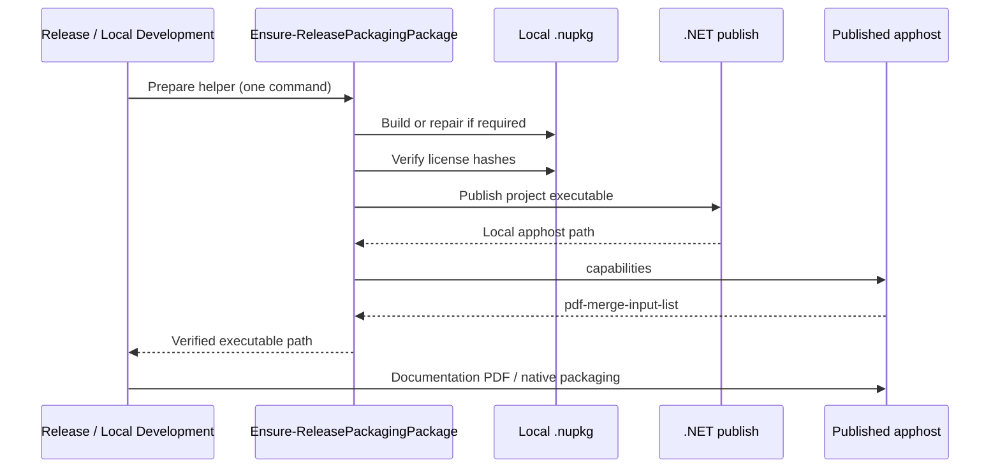
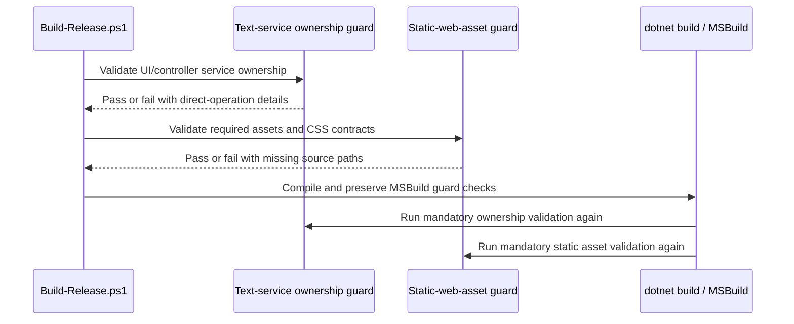

# Build and validation

## Build truth

A successful LocalGPT build is the primary compilation truth. Delimiter counts, regex scans, JSON/XML parsing, IDE inspection, or screenshots cannot replace it.

The repository pins its SDK through `global.json` and provides validation scripts for architecture and policy. When .NET is unavailable, those scripts can still provide partial evidence, but the result must be labeled uncompiled.

Architecture and source-validation maintenance uses only build-wired PowerShell scripts compatible with Windows PowerShell 5.1 and modern `pwsh`. The repository does not maintain a parallel Python test suite; application runtime Python is separate. Source checks derive the current project version and embedded-resource inventory from the `.csproj` file. Release bumps must not require hand-editing static test expectations or introducing version-named test files.

## Validation sequence

A normal maintenance pass should run, as applicable:

1. source formatting and encoding checks;
2. JSON/YAML/XML parsing;
3. C# syntax parsing through the pinned SDK/Roslyn route;
4. architecture assertions;
5. dependency and publish-configuration checks;
6. localization and JavaScript diagnostics checks;
7. database migration/snapshot checks;
8. application build/tests;
9. documentation build and artifact verification;
10. focused browser smoke tests.

## Generated C#

Generated source must preserve namespaces, nullable context, project references, service lifetimes, and existing framework patterns. It must not report compilation success until the target project has actually compiled.

Warnings are triaged by category. Suppression is not the default response to a warning introduced by generated code.

## Static and runtime ownership

Application-owned mutable catalogs, regex lists, runtime values, and policy state are not static. Framework bootstrap and pure immutable helpers remain valid static boundaries.

Runtime-value services own mutable definitions and current values. Persistence services own durable policy. Components consume services rather than constructing global state.

## Logging integrity

Logs contain technical context needed for diagnosis but avoid prompts, full model responses, uploads, generated file contents, credentials, secrets, and unbounded exception data.

The database logger exposes readiness so startup failures do not recurse. User notifications are sanitized; detailed traces remain in the configured logger.

## JavaScript diagnostics

Maintained JavaScript functions used through interop are registered and validated. Build checks detect missing function names and known unsafe patterns. Browser tests cover theme selection, documentation dropdown behavior, fullscreen/close flows, and critical navigation.

## Frontend checks

Important checks include:

- interactive render-mode ownership;
- no nested incompatible render boundaries;
- responsive dialogs and scroll ownership;
- keyboard focus and visible labels;
- clickable menus above decorative layers;
- reduced-motion behavior;
- light/dark contrast;
- no fake or dead controls.

## Documentation checks

The documentation build verifies conceptual pages, generated API YAML/HTML, versioned PDF, Kawaii CSS/JS markers, icon assets, status JSON, and nonzero source/API counts.
DocFX-only reflection dependencies are isolated in `docs/DocfxDependencies.csproj`; they are restored and staged into the temporary documentation probe directory and do not become LocalGPT runtime package references. Unresolved assembly metadata is a hard failure before PDF generation.
Cross-platform release/local-development prerequisites validate the DevExpress license location and provide a compatible Node.js 20–22 runtime for documentation tooling on Windows, macOS, and Linux.
Windows Debug/Release builds use repository-owned PowerShell validation and packaging scripts to validate and seed the version-matched GitHub Pages snapshot from the documentation output of that exact build.

The Pages extractor accepts UTF-8 files with or without BOM, normalizes ZIP separators, rejects unsafe paths, and chooses the strongest complete release candidate.

## Repository-owned packaging helper: one-command execution contract

`Build-Release.ps1` and `Build-LocalDevelopment.ps1` both call `build/Ensure-ReleasePackagingPackage.ps1`. The helper **must** automatically create or repair its distributable NuGet package and verify the original PDFsharp MIT and third-party notice bytes (SHA-256), without requiring the operator to invoke a separate command.

The build runs the **framework-dependent host executable published from the local project source**, not a second NuGet tool installation into `artifacts/release-tools/.store/.stage`. This avoids relying on NuGet tool extraction permissions on external macOS build volumes, while retaining the NuGet package as a separately verified release deliverable. The exact capability `pdf-merge-input-list` is checked against the published executable before starting expensive documentation. A publish or capability failure stops the build rather than silently dropping PDF functionality.

The locally packed NuGet artifact is validated for included license contents; installation of that artifact by unrelated `dotnet tool install` consumers is not established by the direct-apphost smoke check and must be tested separately before claiming package-installability.

## Release preflight: static source assets and text-service ownership (6.0.6)

Normal `pwsh ./Build-Release.ps1` now executes the existing text-service ownership
and static-web-asset guards **before** clearing repository `bin/obj`, preflighting
signing, or building the RID-neutral assembly. Both guards remain in
`Directory.Build.targets` for Visual Studio Debug and the CLI build. A failure
cannot be bypassed by choosing a different entrypoint.

The text-service guard has a locally initialized, intentionally empty reviewed
exception set and self-checks that direct splitting, regex replacement, joining,
and comparison are still detected. New UI/controller text manipulation belongs
in injected services; no new exception baseline was introduced.

The static-asset guard enumerates all image and named web assets declared by
`LocalGPT.csproj` plus the critical runtime files, then verifies that each
file exists. It also enforces four Council evidence popup CSS contracts. If
an asset or CSS contract is absent, it prints the exact source-relative path
or selector before failing. Missing original UI files must be restored;
removing the guard or the project references is not a repair.

The repository's scratch-image exclusion is now anchored at `/images/`. The
previous unanchored `images/` entry matched the authored
`src/LocalGPT/wwwroot/images/` tree and could prevent those source assets from
entering Git. Files already missing from an existing Git checkout must be
restored from authoritative source and committed as appropriate; an ignore
rule change alone does not create missing Git objects. A clean `git status`
does not prove that ignored files are present or tracked.

